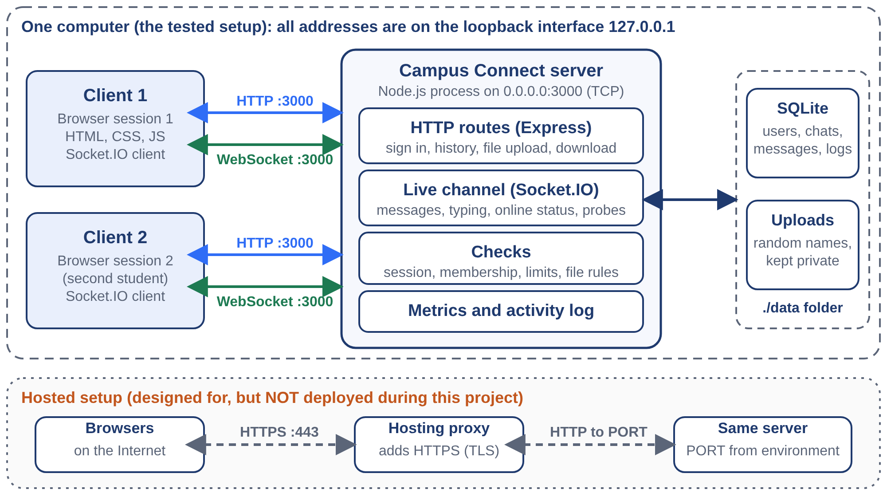

# Campus Connect: Campus Chat and File Sharing System

A small chat and file-sharing website, built to study how **TCP, HTTP and WebSocket** work together in a real application. Students register, chat one to one or in groups, and share files. A **Network** page shows live numbers that the server measures itself (connections, transport, bytes, round-trip time).

| | |
|---|---|
| Course | Computer Networks Laboratory (CSE20110), LCA 3 mini project |
| University | MIT World Peace University, Pune |
| Department | Computer Engineering and Technology |
| Academic year | 2026–2027 |
| Group | 1 |
| Panel | |
| Batch | |
| Faculty | |
| Team member | Harsh Patil (single-member project) |

**YouTube demonstration video:** *link to be added after the video is uploaded*

## Contents

1. [Problem statement and objectives](#1-problem-statement-and-objectives)
2. [Computer Networks concepts demonstrated](#2-computer-networks-concepts-demonstrated)
3. [Design and topology](#3-design-and-topology)
4. [Tools, versions and dependencies](#4-tools-versions-and-dependencies)
5. [Folder structure](#5-folder-structure)
6. [Install and run](#6-install-and-run)
7. [Example inputs and expected results](#7-example-inputs-and-expected-results)
8. [Testing and evidence](#8-testing-and-evidence)
9. [Known limitations](#9-known-limitations)
10. [Suggested improvements for future batches](#10-suggested-improvements-for-future-batches)
11. [Individual contribution and AI use](#11-individual-contribution-and-ai-use)
12. [References](#12-references)
13. [Attribution and licences](#13-attribution-and-licences)

## 1. Problem statement and objectives

**Problem.** Chat apps hide how messages and files travel, so a networking student cannot see which protocol carries a message, how long it takes, or what happens when the connection drops.

**Users and scope.** Students of one campus using a web browser. One server for chat and files, tested on one computer (the loopback interface, `127.0.0.1`).

| ID | Objective | Result |
|---|---|---|
| O1 | Serve the web application from a TCP server on port 3000 and keep accounts, chats and files after a restart | Achieved on the test computer |
| O2 | Deliver chat messages in real time over WebSocket, one to one and in groups, with acknowledgements | Achieved |
| O3 | Share files over HTTP with a live notice to the recipient, and return byte-identical files | Achieved for files up to 15 MB |
| O4 | Fall back to HTTP long-polling when WebSocket is not used, and reconnect after a dropped connection | Achieved in the tests |
| O5 | Refuse requests that are not signed in, come from another website, or break the rules for input, files and sign-in attempts | Achieved for the cases tested |
| O6 | Measure connections, transports, bytes and round-trip time inside the application, and compare WebSocket with long-polling | Achieved, on the loopback interface only |
| O7 | Make the application reachable on a public address | **Not achieved.** The hosting service paused deploys, so the project was run on localhost |

## 2. Computer Networks concepts demonstrated

- **Client–server model** over **TCP port 3000**. The server listens on `0.0.0.0:3000`; each browser connection uses a port chosen by the operating system (see `samples/expected_output/tcp_sockets_port_3000.txt`).
- **HTTP request and response** (sign-in, history, file upload and download) and its **status codes**: 200, 400, 401, 403, 404, 413, 429. Sessions use an `HttpOnly` cookie.
- **WebSocket** for live messages. The browser sends an HTTP request with `Upgrade: websocket`; the server answers `101 Switching Protocols` and the same TCP connection stays open (RFC 6455).
- **HTTP long-polling fallback** through Socket.IO when WebSocket is not used, and the upgrade from polling to WebSocket.
- **Heartbeat and timeouts**: ping every 10 s, timeout 8 s. **Round-trip time** measured by the server with a high-resolution clock.
- **Protection at the network edge**: same-origin (Origin header) check, sign-in rate limit (HTTP 429), message flood limit, upload size and type checks.
- **Layering**: application protocols (HTTP, WebSocket) running over TCP.
- A measured comparison of **WebSocket against HTTP long-polling**.

## 3. Design and topology



- **Browser (client):** HTML, CSS and JavaScript from `public/`, plus the Socket.IO client.
- **Server:** one Node.js process. Express answers HTTP requests; Socket.IO handles the live channel on the same port.
- **Storage:** a SQLite database and an `uploads` folder inside `./data`.
- **Message path:** Student A → WebSocket over TCP → server (checks, saves) → WebSocket over TCP → Student B. Files use HTTP upload, then a live notice over WebSocket, then HTTP download.
- **Addresses used in the tests:** server `0.0.0.0:3000`, clients `127.0.0.1` with operating-system-chosen ports.

More detail on the app (security, monitor, limits) is in `docs/APP_DETAILS.md`.

## 4. Tools, versions and dependencies

| Item | Value |
|---|---|
| Test computer | Linux 6.18 (x86-64), 2 CPU cores, 8 GB RAM |
| Node.js | 22.22.0 (needs **22.13 or newer**, because the built-in `node:sqlite` module is used) |
| npm | 10.9.4 |
| Browser for screenshots | Headless Chromium driven by an automated script |
| Dependency file | `package.json` and `package-lock.json` (exact versions are locked) |

Libraries (installed by `npm install`):

| Library | Version | Purpose |
|---|---|---|
| express | 5.3.0 | HTTP routes and static files |
| socket.io | 4.8.4 | WebSocket with long-polling fallback |
| bcryptjs | 3.0.3 | Password hashing |
| helmet | 8.3.0 | Security headers |
| express-rate-limit | 8.7.1 | Sign-in rate limit |
| multer | 2.4.0 | Multipart file upload |
| cookie | 2.0.1 | Reading the session cookie |
| chart.js | 4.5.1 | Charts on the Network page (a copy is in `public/vendor/`) |
| @fontsource-variable/instrument-sans | 5.3.0 | Font files (copies are in `public/fonts/`) |
| socket.io-client (dev) | 4.8.4 | Used by the tests and the speed test |

## 5. Folder structure

```
README.md                 This file
package.json              Dependencies, start and test commands
package-lock.json         Locked dependency versions
.env.example              Sample settings (sample values only)
server.js                 Server entry point: HTTP routes and the Socket.IO live channel
src/                      Server modules: auth.js, db.js, files.js, metrics.js
public/                   The website (HTML, CSS, JavaScript, fonts, chart library)
tests/run.js              70 automated checks (npm test)
scripts/bench.js          Speed test (WebSocket against long-polling, file transfer)
scripts/raw-websocket-handshake.js   Hand-written WebSocket upgrade over a plain TCP socket
scripts/live-check.js     Optional test of a site that is hosted publicly
samples/                  Sample files to upload and the real outputs from my test run
screenshots/              Screenshots and figures
docs/                     Final report (PDF), presentation (PPTX) and app notes
deploy.js, deploy.cmd, railway.json   Optional helper for hosting on Railway (see section 9)
```

## 6. Install and run

You need **Node.js 22.13 or newer** (check with `node --version`) and internet access once, for `npm install`.

**Start the server first, then open the clients.**

```
cd Group-01_Campus-Connect
npm install
npm start
```

The terminal prints `Campus Connect 1.0.0 listening on 0.0.0.0:3000`. Leave it running.

**Clients:** open `http://localhost:3000` in one browser window, and in a second *private* (incognito) window, so that each window has its own session cookie.

To use another port (example value):

```
PowerShell:   $env:PORT = "4000"; npm start
cmd.exe:      set PORT=4000&& npm start
macOS/Linux:  PORT=4000 npm start
```

Other settings (`MAX_UPLOAD_MB`, `AUTH_RATE_LIMIT`, `DATA_DIR`, `SESSION_SECRET`) are listed in `.env.example`. The server reads them from the environment; none are needed for a normal local run. The database and uploads are created in `./data`. Delete that folder to start fresh. Stop the server with `Ctrl+C`.

## 7. Example inputs and expected results

Use demo values only. Do not use a real college password.

| Step | Input (sample values) | Expected result |
|---|---|---|
| 1. Create account in window 1 | Name `Asha Rao`, username `asha`, password `demo-pass-2026` | Signed in; the dashboard opens |
| 2. Create account in window 2 (private) | Name `Bilal Khan`, username `bilal`, password `demo-pass-2026` | Signed in; the dashboard opens |
| 3. Start a chat | In window 1, **New chat**, pick Bilal | An empty chat opens |
| 4. Send a message | `Hello Bilal` in window 1 | Appears in window 2 at once; the header badge shows **Connected · WebSocket** with a round-trip time |
| 5. Send a file | **Attach a file**, choose `samples/sample_files/CN_notes_sample.pdf` | Window 2 shows a file card with a **Download** button; the download is identical to the original |
| 6. Network page | Open **Network** in either window | 2 active connections (WebSocket), messages sent, files transferred, bytes, latest round-trip time |
| 7. Refused file | Attach `samples/sample_files/not_a_real_pdf.pdf` (text renamed to `.pdf`) | Refused with HTTP 400: "does not look like a real .pdf file" (the first bytes do not match a PDF) |
| 8. Bad input | Register with password `123` | Error: "Password must be at least 8 characters." |

Screenshots of these screens are in `screenshots/` (see section 8).

## 8. Testing and evidence

### Automated checks

```
npm test
```

`npm test` starts its own copy of the server on a free port, so the main server does not need to be running. It runs **70 checks** in nine groups (health and protection, accounts, live messaging, file sharing, search, network monitor, polling fallback and reconnection, restart, sign-in rate limit). Expected last lines:

```
70 checks passed, 0 failed
```

My run is saved in `samples/expected_output/npm_test.log`.

### Speed test

With the server running, in a second terminal:

```
node scripts/bench.js http://127.0.0.1:3000
```

It creates demo accounts named `bench_*`. Add `--json` for machine-readable output. My result is in `samples/expected_output/speed_test_result.json` (21 Oct 2026, Node.js 22.22.0, loopback, one computer):

| Measurement (ms) | Samples | Median | 95th percentile |
|---|---|---|---|
| WebSocket, delivery to the other student | 100 | 1.65 | 2.63 |
| HTTP long-polling, delivery to the other student | 40 | 4.90 | 8.06 |
| WebSocket, acknowledgement | 100 | 1.74 | 3.36 |
| HTTP long-polling, acknowledgement | 40 | 7.42 | 11.74 |
| 15 MB file upload / download (median of 3 runs) | 3 | 91.57 / 76.24 | n/a |

Your numbers will differ with your computer. **These are loopback numbers**: there is no real network delay, so they show the cost of the protocol and the application, not Wi-Fi or Internet speed.

### Protocol evidence

With the server running:

```
node scripts/raw-websocket-handshake.js
curl -i http://127.0.0.1:3000/health
```

(In PowerShell use `curl.exe`.) The first command sends a hand-written WebSocket upgrade over a plain TCP socket three times. Expected: a valid 16-byte key gets `101 Switching Protocols`; a 17-byte key gets `400 Bad Request`; a request that claims to come from another website is refused. My output is in `samples/expected_output/websocket_handshake.txt`, and the TCP sockets seen on port 3000 are in `samples/expected_output/tcp_sockets_port_3000.txt`. No packet-capture tool (Wireshark, tcpdump) was available in the test environment, so the evidence is at application level.

### Screenshots

| File | Shows |
|---|---|
| `screenshots/01_dashboard.jpg` | Dashboard |
| `screenshots/02_chat_with_file.jpg` | Chat with a shared file |
| `screenshots/03_files_page.jpg` | Files page |
| `screenshots/04_network_monitor.jpg` | Network page with live measurements |
| `screenshots/05_activity_log.jpg` | Activity log (connections, upgrades from polling to WebSocket) |
| `screenshots/06_connection_lost.jpg`, `07_reconnected.jpg` | Browser while the connection is cut, and after it returns |
| `screenshots/08_npm_test_summary.png` | Summary of the `npm test` output by group |
| `screenshots/09_speed_test_chart.png` | WebSocket against long-polling |
| `screenshots/10_architecture_and_topology.png` | Architecture and topology |
| `screenshots/11_protocol_evidence.png` | Protocol evidence from the running server |

## 9. Known limitations

- All measurements come from **one computer on the loopback interface**. Real LAN, Wi-Fi, Internet delay, packet loss and proxies were not tested.
- The project was **not hosted publicly**. A Railway deployment was attempted (`deploy.js`, `deploy.cmd`, `railway.json`), but the hosting service answered that deploys were paused, so objective O7 was not achieved. HTTPS, the `Secure` cookie flag and `wss://` were therefore not checked on a public address.
- The checks were run on **Linux**. The code should also run on Windows and macOS with Node.js 22.13 or newer, but this was not tested there.
- No packet-capture tool was used (see section 8).
- One server process only: presence, counters and Socket.IO rooms are kept in memory. Two copies of the server would need a shared adapter such as Redis.
- `node:sqlite` is still marked experimental when it left its flag in Node.js 22.13, so Node may print a warning (the start script hides it).
- Uploaded files are checked by type and first bytes but are **not scanned for malware**; files are stored unencrypted on the server's disk.
- No password reset and no e-mail. Only three students and a ten-receiver group were tested; no load test was run.

## 10. Suggested improvements for future batches

- Host it with a persistent volume and HTTPS, then repeat the tests and the speed test from phones and laptops on a real network.
- Capture traffic with Wireshark on a real LAN to show the handshake and frames at packet level.
- Add a shared adapter (for example Redis) so several server copies can share rooms and presence.
- Add a load test with many simultaneous users and large groups.
- Add password reset through the college e-mail and malware scanning of uploads.

## 11. Individual contribution and AI use

**Harsh Patil (single member):** project definition and requirements, the Railway deployment attempt, demonstration and submission.

**AI use:** Claude (an AI assistant from Anthropic) helped write the code, the automated checks, the speed-test script, the diagrams, the report and the slides. All numbers in this repository were produced by running the code (`npm test`, `scripts/bench.js` and the protocol commands) in a Linux workspace on 21 October 2026; they were not written by the AI. The standards and documentation listed in the references were opened and read on that date. The outputs have **not yet been repeated on the student's own computer**, so please re-run `npm test` as shown in section 8.

## 12. References

1. R. Fielding, M. Nottingham, and J. Reschke, Eds., "HTTP Semantics," RFC 9110, IETF, 2022. [Online]. Available: https://www.rfc-editor.org/rfc/rfc9110
2. W. Eddy, Ed., "Transmission Control Protocol (TCP)," RFC 9293, IETF, 2022. [Online]. Available: https://www.rfc-editor.org/rfc/rfc9293
3. I. Fette and A. Melnikov, "The WebSocket Protocol," RFC 6455, IETF, Dec. 2011. [Online]. Available: https://www.rfc-editor.org/rfc/rfc6455
4. Socket.IO, "How it works," Socket.IO Documentation, v4. [Online]. Available: https://socket.io/docs/v4/how-it-works/
5. Node.js, "SQLite," Node.js API Documentation. [Online]. Available: https://nodejs.org/api/sqlite.html
6. Socket.IO, "Server options," Socket.IO Documentation, v4. [Online]. Available: https://socket.io/docs/v4/server-options/

All sources were accessed on 21 October 2026.

## 13. Attribution and licences

- The libraries in section 4 are open-source packages used as published; their licences are listed in `THIRD_PARTY_NOTICES.md`. The licence text of the Instrument Sans font is kept in `public/fonts/LICENSE-instrument-sans.txt`, and the Chart.js licence notice is kept at the top of `public/vendor/chart.umd.min.js`.
- Diagrams, screenshots and the report were made for this project.
- No licence has been chosen for the project's own code yet. Public sharing and educational reuse need the faculty's permission under institutional practice.
- No passwords, access tokens or private keys are included. The sample passwords above are demo values.
